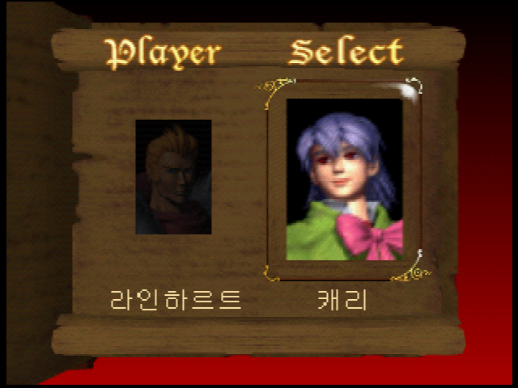
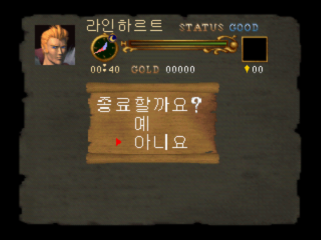
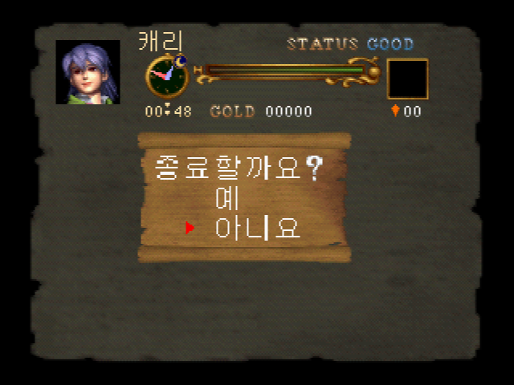

**악마성 드라큘라 묵시록 · N64 일본판 한국어 패치 v0.65**

**v0.65 수정 사항**

- 종료 확인을 **종료할까요?**로 줄여 창 안에 표시합니다. 파일 처리 확인의 잘못된 '사용할까요?'도 **진행할까요?**로 고쳤습니다.
- 캐릭터 이름을 공통 메뉴 문자열에서 한글화해 선택 화면과 일시정지 메뉴에 적용했습니다. 다른 영어 메뉴·부제·음성은 유지합니다.
- 선택 화면 이름을 초상화 아래 가운데에 맞추고 **4픽셀 아래로** 내렸습니다.
- 일시정지 메뉴 이름의 **0.9배 축소를 1배**로 바꾸어 한글 획이 뭉개지는 표시를 수정했습니다.
- 전체 원문 **934개, 중복 포함 1,071구간**을 다시 대조했습니다. 저장 공간·메모 칸 부족 안내도 고쳤습니다.
- v0.6.1의 지역명 13개 한 줄 표시 수정을 포함합니다. 원본 표시 시간은 유지합니다.

일본어 텍스트 1,067구간과 일본어 로고를 한국어로 바꿨으며, 이번 판에는 공통 이름 4개 항목도 한글화했습니다(미사용 이름 2개 포함). 컷신은 게임 엔진의 기존 자막 명령과 타이밍을 유지합니다. 띄어쓰기는 U+0020 반각 공백이며 게임 안에서는 8픽셀입니다.

**일본판 원본에 다시 패치하고 새로 부팅해 주세요.** 게임 안의 저장 기능으로 이어 할 수 있습니다.

Windows 10/11 x64에서는 [EXE 패처](https://github.com/OldManCraveGuitars-bit/N64-Akumajou-Dracula-Mokushiroku-Real-Action-Adventure-Kr/releases/download/v0.65/N64-Akumajou-Dracula-Mokushiroku-Kr-v0.65-Patcher.exe) 또는 [Windows ZIP](https://github.com/OldManCraveGuitars-bit/N64-Akumajou-Dracula-Mokushiroku-Real-Action-Adventure-Kr/releases/download/v0.65/N64-Akumajou-Dracula-Mokushiroku-Kr-v0.65-Windows.zip)을 받으세요. Python 설치 없이 실행합니다. [BPS 단독 패치](https://github.com/OldManCraveGuitars-bit/N64-Akumajou-Dracula-Mokushiroku-Real-Action-Adventure-Kr/releases/download/v0.65/Akumajou-Dracula-Mokushiroku-Korean-v0.65.bps), [텍스트 도구](https://github.com/OldManCraveGuitars-bit/N64-Akumajou-Dracula-Mokushiroku-Real-Action-Adventure-Kr/releases/download/v0.65/Text-Tool-v0.65.zip), [스크린샷 모음](https://github.com/OldManCraveGuitars-bit/N64-Akumajou-Dracula-Mokushiroku-Real-Action-Adventure-Kr/releases/download/v0.65/Screenshots-v0.65.zip), [SHA256 목록](https://github.com/OldManCraveGuitars-bit/N64-Akumajou-Dracula-Mokushiroku-Real-Action-Adventure-Kr/releases/download/v0.65/SHA256SUMS.txt)도 제공합니다.

1. 패처 EXE를 실행하고 일본판 원본 롬을 선택합니다.
2. 새 출력 파일 경로를 고르고 **한글 패치 적용**을 누릅니다.
3. 완료 후 표시된 결과 SHA256을 확인합니다.
4. 만들어진 .z64 롬을 새로 부팅하고 게임 안의 저장 데이터를 불러옵니다.

원본 크기는 **12 MiB**, 패치 결과는 **16 MiB**입니다. .z64/.v64/.n64의 바이트 순서를 자동 판별하며 원본을 보존합니다. 기존 출력 파일이 있으면 새 이름을 선택하세요. 일반 BPS 프로그램은 big endian .z64 원본에 적용합니다.

원본 정규화 **SHA1**: `aa70348968589e6ba6e7091ca115fb505099cd97`

| 대상 | SHA256 |
| --- | --- |
| 원본 .z64 (바이트 순서 정규화) | `f5b8a1bd8dd4d03b5fe291428b284ca30d9afd300fe25f60317aa1e4590db638` |
| 원본 .v64 (제공된 파일) | `078ac90a17f6fad57300a95fff7d4a9c34bc1d981009ba965bd637df84a9f2eb` |
| 패치 결과 .z64 | `74a61c6630ec118e920a886024bee4f9d9808aacb5f302e9030d8db3825f7182` |
| Windows EXE | `30a2565f4d847bf24a936979049eb6454d8815f1864ec778340dc1aeeda14bd8` |
| BPS 패치 | `05d5ab8a2c6d20833ec24d29c5cbfd056a46f05a144ac29d243571480e431e80` |
| Windows ZIP | `6e5bed6aaa3ef19c91c827cc31b5ae8dede3202eac19fb5db0d8bd412846b008` |

실제 EXE로 세 가지 바이트 순서의 원본을 패치해 같은 결과 해시를 확인했습니다. 잘못된 원본·손상된 패치·원본 및 기존 출력 덮어쓰기 차단, GUI 시작, 텍스트 도구의 동일 결과 재빌드도 검사했습니다.

254개 자산과 28개 맵 문구 포인터, 번역 폭·페이지·참조·N64 체크섬을 검사했습니다. 최종 빌드에서 두 캐릭터 새 부팅과 선택 화면, 오프닝, 종료의 예/아니요, 두 캐릭터 아이템 메뉴, 실제 저장과 새 부팅 불러오기, 엔딩과 수정 컷신을 실행했습니다. 지역명 13개도 실행해 자동 스크롤 없이 한 줄로 표시되고 원본의 표시 시간을 유지하는지 확인했습니다.

앞선 빌드에서 검사한 두 주인공 × 27개 지역 로딩, 컷신 54개 진입 조건, 문구 누락·텍스처 검수 기록도 보존합니다. **모든 분기를 처음부터 끝까지 완주한 검증은 아닙니다. 일부 저해상도 배경 글씨와 모든 이미지 형식의 전수 확인은 마치지 않았습니다.**

초상화 아래 가운데 정렬 및 위치 조정

종료할까요? / 일시정지 메뉴의 한글 이름

캐리 일시정지 메뉴

한 줄로 표시되는 침묵의 숲

오프닝 한글 자막

캐리 대사

화이트 주얼 저장창

아이템 메뉴

텍스트 도구는 `text-tool/텍스트_도구_실행.cmd`로 실행합니다. Python 3.11 이상과 Pillow가 필요하며, 첫 실행에서 원본을 선택합니다. 원문·번역·ID 검색, 실제 글꼴 미리보기, Ctrl+S 저장, 폭/영문 보존 검증, 롬 빌드를 지원합니다.

패처 소스 실행: `python patcher_app.py`

EXE 빌드: `python -m pip install -r requirements-build.txt` 후 `scripts/build_exe.ps1`을 실행합니다. 게임 원본과 완성 롬은 배포 파일에 포함되지 않습니다. 게임의 권리는 원 권리자에게 있습니다.

분해 구조 참고: [k64ret/cv64](https://github.com/k64ret/cv64). 이번 재검수 기록은 [docs/review-v0.65.json](docs/review-v0.65.json), 이전 검수 기록은 [docs/proofreading.json](docs/proofreading.json), 검증 기록은 [docs/validation.json](docs/validation.json)에 있습니다.
